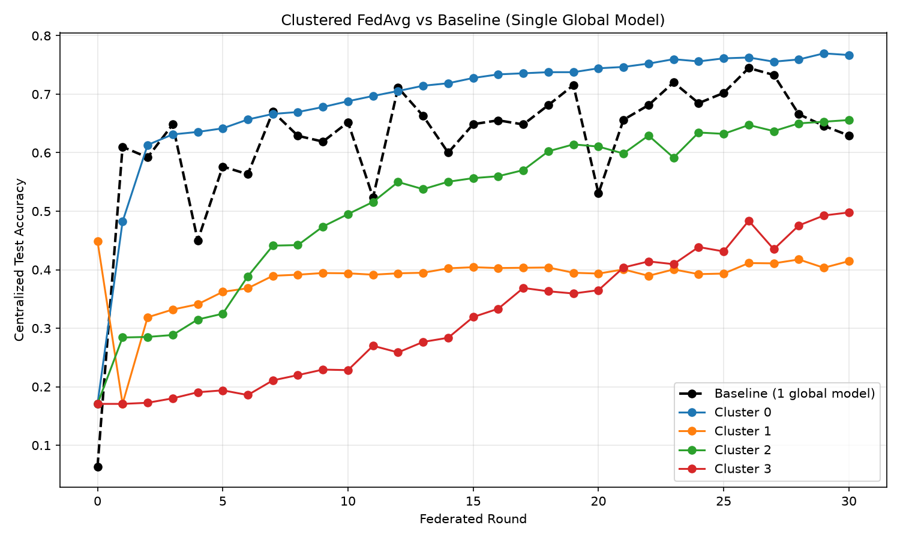

# FedHealth 🏥

FedHealth is a federated learning platform for **chest X-ray disease detection across hospitals**, with **similarity-based client clustering**. Hospitals train a shared model without ever exchanging patient images, and a role-based web app lets admins run **live federated training**, hospitals classify X-rays, and patients upload X-rays and reports with **OCR (EasyOCR)**.

> ⚠️ **Academic prototype. Not a medical device.** Predictions are for demonstration only and must not be used for diagnosis.

**Authors:** [Author names] · **Guide:** [Faculty name] · **Course:** Software Engineering mini project

---

## 🚀 Features

* 🏥 **Simulated Hospital Network** – 20 hospitals with deliberately skewed (non-IID) disease mixes
* 🔗 **Similarity-Based Clustering** – Hospitals are grouped with k-means on their class distributions, and FedAvg runs separately inside each cluster
* ⚡ **Live Federated Training** – An admin picks hospitals and rounds, and a real FedAvg run executes on the server while accuracy streams to the browser over WebSockets
* 🩻 **X-Ray Classification** – Detects COVID-19, Normal, Lung Opacity and Viral Pneumonia
* 🔍 **Explainable Predictions** – A Grad-CAM heatmap for every class, plus a coarse region-of-interest box on the predicted class
* 🗂️ **Batch Dataset Upload** – A hospital uploads a `.zip` of X-rays and gets a results table with per-class counts
* 🧾 **Patient Portal with OCR** – Patients upload an X-ray and a report image, and the report text is extracted and shown with disease keywords flagged
* 🔐 **Role-Based Access** – Separate admin, hospital and patient accounts, enforced on the server
* 📊 **Dashboard Views** – Accuracy curves (baseline vs. clustered), confusion matrix, per-class precision / recall / F1 and the model architecture
* 💾 **SQLite Database** – Accounts, prediction history, patient records and training runs

---

## 🛠️ Tech Stack

* **Frontend:** HTML, CSS, JavaScript (Chart.js, Socket.IO client)
* **Backend:** Python (Flask, Flask-Login, Flask-SQLAlchemy, Flask-SocketIO)
* **Database:** SQLite3
* **Machine Learning:** PyTorch, Torchvision, Flower, scikit-learn
* **OCR Engine:** EasyOCR

---

## 🧩 Architecture


The experiment scripts produce the hospital partitions, cluster assignments and accuracy histories as JSON files. The web app reads those files and also runs its own live training loop, written as plain FedAvg in PyTorch because Flower's Ray backend doesn't run reliably inside a web-server thread.

---

## 📝 Project Structure

```
FedHealth/
├── data/
│   └── prepare_data.py          # Resizes images, makes the 90/10 train/test split
├── simulation/
│   ├── config.py                # Class names
│   ├── model.py                 # ChestCNN model + dataset class
│   ├── partition.py             # Non-IID split across 20 hospitals
│   ├── run_baseline.py          # Baseline FedAvg (Flower)
│   └── results_baseline.json    # Baseline accuracy per round
├── clustering/
│   ├── cluster_clients.py       # k-means clustering of hospitals
│   ├── run_clustered.py         # FedAvg inside each cluster (Flower)
│   ├── cluster_assignments.json
│   └── results_clustered.json   # Accuracy per round, per cluster
├── webapp/
│   ├── backend/
│   │   ├── app.py               # Flask server: auth, API, Socket.IO
│   │   ├── models.py            # Database tables
│   │   ├── gradcam.py           # Grad-CAM + region-of-interest box
│   │   ├── ocr.py               # EasyOCR text extraction
│   │   ├── live_trainer.py      # Live FedAvg in PyTorch
│   │   ├── train_demo_model.py  # Trains the model the app serves
│   │   ├── compute_metrics.py   # Confusion matrix, precision/recall/F1
│   │   ├── seed_db.py           # Creates the database + demo accounts
│   │   └── requirements.txt
│   └── frontend/
│       ├── index.html           # Main dashboard
│       ├── login.html           # Sign-in page
│       ├── register.html        # Patient registration
│       ├── style.css
│       └── script.js
├── docs/                        # Architecture diagrams
├── requirements.txt
└── README.md
```

---

## 🔧 Installation & Setup Guide 🔧

### 📚 Prerequisites

Before you begin, make sure you have:

* [Python](https://www.python.org/downloads/) (3.10–3.12, 3.11 recommended)
* [Git](https://git-scm.com/)
* A free [Kaggle](https://www.kaggle.com/) account (to download the dataset)
* A few GB of free disk space, and internet for the first install (PyTorch and the EasyOCR model are large downloads)

---

### 1. Clone the Repository

```bash
git clone https://github.com/<username>/<repo>.git
cd <repo>
```

---

### 2. Create a Virtual Environment

```powershell
python -m venv venv
venv\Scripts\Activate.ps1
```

On macOS / Linux use `source venv/bin/activate` instead. If PowerShell blocks the script, run this first:

```powershell
Set-ExecutionPolicy -ExecutionPolicy RemoteSigned -Scope Process
```

Your prompt should now start with `(venv)`.

---

### 3. Install Dependencies

```bash
python -m pip install --upgrade pip
pip install -r requirements.txt
pip install -r webapp/backend/requirements.txt
```

**Dependencies Explained:**

* **torch / torchvision** = Deep learning framework and image utilities for the CNN
* **flwr[simulation]** = Flower, used for the baseline and clustered FedAvg experiments
* **scikit-learn** = k-means clustering and PCA
* **flask, flask-login, flask-sqlalchemy** = Web server, authentication and the SQLite database
* **flask-socketio** = Real-time progress updates during live training
* **easyocr** = Text extraction from uploaded reports

Check that everything installed:

```bash
python -c "import torch, torchvision, flask, flask_login, flask_socketio, flask_sqlalchemy, easyocr; print('all good')"
```

---

### 4. Download and Prepare the Dataset

The dataset is not stored in this repo. Download the **COVID-19 Radiography Database** from Kaggle:

<https://www.kaggle.com/datasets/tawsifurrahman/covid19-radiography-database>

Extract it so that `data/raw/` contains the four class folders `COVID`, `Normal`, `Lung_Opacity` and `Viral Pneumonia`. Then run:

```bash
python data/prepare_data.py
```

This writes 128×128 images to `data/processed/train` and `data/processed/test`.

---

### 5. Run the Federated Learning Experiments

Run these in order from the project root:

```bash
python simulation/partition.py        # Splits data across 20 non-IID hospitals
python simulation/run_baseline.py     # Baseline FedAvg, 30 rounds (about 30 min on a CPU laptop)
python clustering/cluster_clients.py  # Clusters hospitals by class distribution
python clustering/run_clustered.py    # FedAvg per cluster (the slowest step)
```

💡 To test quickly first, set `NUM_ROUNDS = 3` at the top of `run_baseline.py` and `run_clustered.py`, then set it back to 30 for the real run.

> **Moving the project to another computer?** `simulation/client_indices.json` stores absolute image paths from the machine that created it. Either rewrite those paths, or re-run `python simulation/partition.py` to regenerate the file for your machine. A regenerated split can differ slightly from the original.

---

### 6. Prepare the Web App

```bash
python webapp/backend/train_demo_model.py
python webapp/backend/compute_metrics.py
python webapp/backend/seed_db.py
```

* `train_demo_model.py` trains the model the app serves (20 epochs, roughly 45–90 minutes on CPU). Skip it if `webapp/backend/demo_model.pt` already exists.
* `compute_metrics.py` creates `metrics.json` for the Results page.
* `seed_db.py` creates the database and demo accounts. ⚠️ It **wipes and rebuilds** the database, including patient accounts, so don't re-run it if you want to keep existing data.

---

### 7. Run the Server

```bash
python webapp/backend/app.py
```

✅ Server runs at: `http://127.0.0.1:5000`

---

### 8. Log In

| Role | Login | What you can do |
|---|---|---|
| 🛠️ **Admin** | `admin` / `admin123` | Start and stop live training, view training history and all hospitals |
| 🏥 **Hospital** | `hospital0` / `hospital0` … `hospital19` / `hospital19` | Classify X-rays, batch-classify a zip, view its own history |
| 🧑 **Patient** | Register at `/register` | Upload your own X-ray and report, view your own records |

The demo credentials and the development secret key in `app.py` are for local use only. Change them before any real deployment.

**Try it:** as `admin`, open *Live Training*, tick three hospitals, choose 3 rounds and press Start. As `hospital0`, upload an X-ray under *Classify X-Ray*, or a small zip under *Batch Dataset Upload*.

---

## 📊 Results

Accuracy after 30 federated rounds, measured on the shared 2,115-image test set (all four classes):

| Model | Hospitals | Final accuracy |
|---|---|---|
| Baseline FedAvg (one global model) | 20 (5 sampled per round) | 62.9% (peak 74.5%) |
| Cluster 0 | 8 | 76.7% |
| Cluster 1 | 3 | 41.5% |

The baseline curve is unstable, while every cluster curve is smoother. The largest cluster ends clearly above the baseline's final round and the smallest clusters end below it, so clustering trades group similarity against data volume. Exact values for every cluster are in `clustering/results_clustered.json`.



Each configuration was run once with a single seed, the baseline samples 5 of 20 hospitals per round while clusters use all their members, and cluster models are scored on the global four-class test set. Treat the results as indicative, not as a controlled comparison.

---

## ⚠️ Limitations

* The hospital network is simulated on one machine (hospitals are data partitions, not separate servers)
* The model served by the app is trained centrally, not by federated training
* The region-of-interest box is coarse and is not a trained detector
* OCR only extracts and displays text; it does not interpret reports
* Only four conditions are supported, and nothing here is clinically validated
* A per-hospital personalization layer was part of the original proposal but is not implemented
* There is no automated test suite yet
